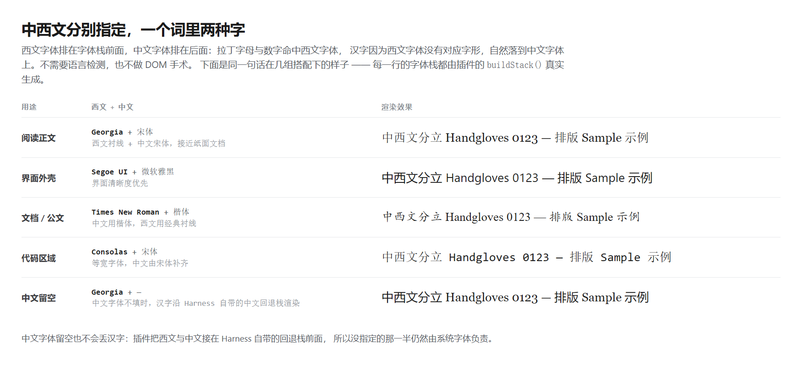
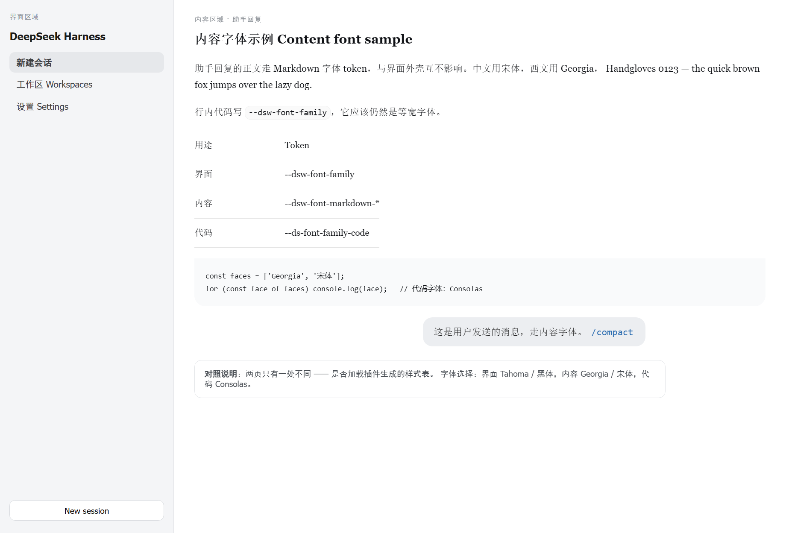
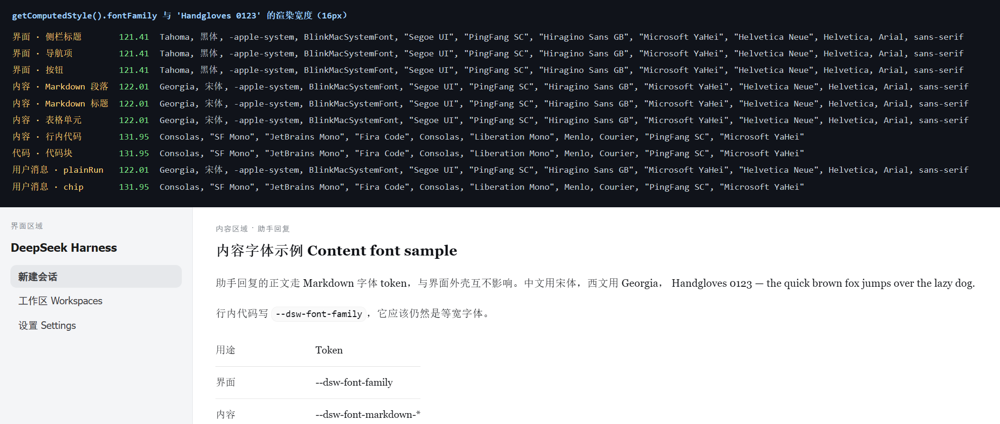

# dsh-font-master

**给 DeepSeek Harness 换字体的插件：中西文分别指定，界面 / 内容 / 代码三处独立。**



Harness 官方的「设置 → 通用」只有配色和字号，没有字体族入口；而现有第三方字体插件都改同一个
`--dsw-font-family`，界面和正文必然一起变。这个插件把三件事拆开了：

| | 能分别设定 | 效果 |
|---|---|---|
| **文种** | 西文 / 中文 | 一句话里两种字：拉丁字母走西文字体，汉字走中文字体 |
| **用途** | 界面 / 内容 / 代码 | 侧栏外壳、会话正文、代码等宽区各用各的，互不牵制 |

字体选择是 Word 式的：**菜单列出这台机器上装的全部字体族**，每一行用它自己的字面渲染，
按中文 / 等宽 / 西文分组，中英文名都能搜，并记住最近用过的几个。


设置位置：**设置 → 字体 / Fonts**，共 6 个槽位（3 处用途 × 2 个文种）。

---

## 优势一：西文与中文分开选

### 为什么这一条重要

一份中英混排的界面里，西文和中文的美学诉求经常是冲突的：

- 界面外壳要**清晰**：无衬线、x-height 大、屏幕上小字可读 → Segoe UI / Inter / 苹方黑体
- 阅读正文要**耐读**：衬线、笔画对比明确 → Georgia / 宋体
- 代码要**对齐**：等宽 → Consolas / JetBrains Mono

而「西文用 Georgia、中文用微软雅黑」这种搭配，在任何单一字体下拉框里都表达不出来 ——
选了 Georgia，中文就跟着变成系统默认的宋体或黑体；选了微软雅黑，西文就变成雅黑自带的
平庸拉丁字形。dsh-font-master 让这两半各自独立。

### 实现方式

不需要语言检测，也不做 DOM 手术，只是一条标准的字体回退链：

```
'Georgia', '宋体', -apple-system, BlinkMacSystemFont, …
    ↑         ↑
  拉丁命中   汉字在西文里没有字形 → 落到这里
```

西文字体排在前面，中文字体排在后面，浏览器按字形逐字符回退，天然完成分工。
**中文字体留空也不会丢汉字**：插件把选中的字体接在 Harness 自带的中文回退栈前面，
没指定的那一半仍由系统字体负责。

---

## 优势二：界面 / 内容 / 代码分开管



上图加载的是**真实的** DSH 样式表（从 `app.asar` 导出的 shell 样式表与 `ui-theme` 令牌表），
三种用途分别落在三套字体上：界面 Tahoma / 黑体，内容 Georgia / 宋体，代码 Consolas。

「内容字体」覆盖助手回复的 Markdown（段落、标题、表格、列表）**以及你发送的消息**；
代码块、行内代码、diff、JSON 树始终走代码字体，不会被内容字体压掉。

「跟随界面字体」开关可以让内容字体直接沿用界面字体——只想换一处时不用填两遍。

---

## 字体菜单列的是本机字体表

Word 的字体下拉之所以好用，是因为它列的就是这台机器上真实装了的字体。浏览器默认做不到：
`queryLocalFonts()` 要先弹权限框，而且部分 Electron 构建根本不支持。

所以清单由**宿主半侧读字体文件**得到：

1. 按平台扫字体目录 —— Windows 是 `%WINDIR%\Fonts` 加 `%LOCALAPPDATA%\Microsoft\Windows\Fonts`，
   macOS 是 `/System/Library/Fonts`、`/Library/Fonts`、`~/Library/Fonts`，Linux 是
   `/usr/share/fonts` 等。
2. 逐个读 sfnt 结构：从 `name` 表取字体族名（优先 16 号排版族名，退回 1 号族名），
   并把**每一条本地化记录都收作搜索别名**——所以搜「雅黑」和搜「YaHei」都能找到 `Microsoft YaHei`。
3. 顺带读 `OS/2` 与 `post` 给字体打标签：中文（`ulUnicodeRange2` 的 CJK 位）、
   衬线/无衬线（PANOSE）、等宽（`post.isFixedPitch`）。
4. 同一个族的多套字面（Regular / Bold / Italic）合并成一条，列出时正体在前。
5. 结果按目录内容指纹缓存到 `$DSH_HOME/dsh-font-master/fonts.json`，
   字体没增删就不重扫，正常启动只走一次目录遍历；界面上也有「重新扫描」。

只读取头部的几百个字节，不会把 20MB 的中文集全部读进来——本机 260 个字体文件、157 个字体族，
整轮扫描约 55ms。

清单通过一条 HTTP 路由（`/dsh-font-master/fonts`）交给浏览器半侧，路由套用与 Web 界面其余部分
相同的信任检查。桌面端渲染进程的 origin 是 `dsh-app://app`，该协议的处理器会把非静态资源
**带鉴权 cookie 转发**到本地 HTTP 服务，所以相对路径 `fetch` 在桌面端和 `dsh web` 下同样有效。

拿不到清单时（没有 web server 的组合、路由被拒、响应为空）会退回一份内置候选表，
并清楚标明「读不到本机字体清单」——菜单永远可用，只是不再完整。

### 等宽判定为什么不用 PANOSE

PANOSE 里有一个「proportion = 9」表示等宽。但中文字体普遍会把它标成 9，因为汉字本来就是全角——
本机的 `SimHei`、`KaiTi`、`FangSong` 都是这样，照搬会把一堆正文宋黑体塞进代码字体候选。
`post.isFixedPitch` 是字体对自己拉丁字宽的自述，用它才是对的；只有在字体没有 `post` 表时
才退回 PANOSE。这条实测踩过，测试里也钉住了。

---

## 为什么不是现成插件

GitHub / npm 上已有的字体插件都只覆盖了上面两个维度里的一部分：

| 插件 | 中西文分开 | **界面 / 内容分开** | 代码字体 |
|---|---|---|---|
| [LX-HMKK/DSH-appearance](https://github.com/LX-HMKK/DSH-appearance) | ✅ | ❌ 共用一栏 | ✅ |
| [lsh2002/dsh-custom-fonts](https://github.com/lsh2002/dsh-custom-fonts) | ✅ | ❌ 共用一栏 | ✅ |
| [WangPaoPaoLab/dsh-font](https://github.com/WangPaoPaoLab/dsh-font) | ❌ 自动搭配 | ❌ | ✅ |
| [Gan332/dsh-typography](https://github.com/Gan332/dsh-typography) | ❌ | ❌ | ✅ |
| [yuu1111/dsh-ui-font](https://github.com/yuu1111/dsh-ui-font) | ❌ | ❌ | ✅ |
| [rhczz/dsh-plugin-ui-font-family](https://github.com/rhczz/dsh-plugin-ui-font-family) | ❌ | ❌ | ❌ 明确不改代码块 |

没有任何一个把**界面**和**内容**分成两栏——它们改的都是同一个 `--dsw-font-family`，
界面和正文必然一起变。本插件补的就是这一栏。

---

## 安装

插件是一个 **bundle 包**：`package.json` 声明了 `dsh.bundle.patch` 与 `dsh.client`。

```sh
dsh plugin --profile desktop add github:AnAcretiondisk9986/dsh-font-master
# 或本地目录
dsh plugin --profile desktop add "link:<本仓库绝对路径>"
```

<details>
<summary>没有 dsh CLI 时的手动装法</summary>

1. `$DSH_HOME/profiles/<profile>/package.json`：
   - `dependencies` 加 `"dsh-font-master": "link:<本仓库绝对路径>"`
   - `dsh.profile.bundles` 数组追加 `"dsh-font-master"`
2. `$DSH_HOME/profiles/<profile>/node_modules/dsh-font-master` 建目录联接（junction）指向本仓库根。
3. 重启一次 DSH。

bundle 列表在启动时组装，所以**重启是标准路径**。实测中运行中的实例也会在行被加入后直接接管
（`plugin_manager` 里 `include:dsh-font-master` 变为 `fiberPhase: active`），但重启仍是可靠的那条路。
</details>

卸载：`dsh plugin --profile desktop remove dsh-font-master`，或反向做一遍。

---

## 原理

### 是 token 覆盖，不是 DOM 改造

Harness 的 web 端把字体收敛到两个自定义属性上：

```css
:root{
  --dsw-font-family: -apple-system, BlinkMacSystemFont, "Segoe UI", …;  /* 界面 + 正文 */
  --ds-font-family-code: "SF Mono", "JetBrains Mono", …;                 /* 等宽区域 */
}
```

`--dsw-font-family` 同时被界面和正文消费，所以**光靠它无法把两者分开**。
但正文并不是直接用它：`ui-theme` 的 `gradient-shadow-text.css` 在 `body` 上派生了
一整套 Markdown 字体 token，每一个的末端都是 `var(--dsw-font-family)`：

```
--dsw-font-markdown-base          --dsw-font-markdown-h1 … -h4
--dsw-font-markdown-base-strong   --dsw-font-markdown-table / -table-head
--dsw-font-markdown-small …       --dsw-font-markdown-code*
```

这一层就是插件插入的位置：

- 把 `--dsw-font-family` 换掉 → **界面字体**（以及所有由它派生的壳层文字）
- 把上面那批 `--dsw-font-markdown-*` 换掉 → **内容字体**（只有正文变）
- 把 `--ds-font-family-code` 换掉 → **代码字体**

插件只维护一张样式表，不碰任何组件的 CSS：

```css
html,body{
  --dsw-font-family:'Inter', '微软雅黑', … !important;
  --ds-font-family-code:'JetBrains Mono', … !important;
  --dsw-font-mono:'JetBrains Mono', … !important;
  --dsw-font-markdown-base:var(…-font-style,normal) var(…-font-weight,400) … !important;
  …
}
```

### 三个刻意的取舍

| 决策 | 原因 |
|---|---|
| `!important` | `ui-theme` 在 `:root` 和 `body` 上都声明这些变量，`ui-layout` 还会把解析后的主题快照写成 `document.body` 的行内自定义属性——普通规则压不住。 |
| Markdown 简写用**兄弟长属性**重组，而不是复制字号公式 | 每个 `--dsw-font-markdown-*` 都有配套的 `-font-style/-font-weight/-font-size/-line-height`。用它们拼出 `font` 简写，意味着 Harness 调整字号阶梯时插件不用跟着改。`tools/test.mjs` 会对着真实的 `ui-theme` 样式表逐条核对这些 token 仍然存在。 |
| 只覆盖有值的分组 | 某一栏留空就完全不输出对应声明，等于「跟随 Harness 默认」，也就不会和其它主题 / 字体插件打架。 |

### 用户消息那一条选择器

助手回复的正文走 Markdown token，但**用户自己发的消息**不是 Markdown：它是气泡里的
`.plainRun` 文本片段，字体继承自 `--dsw-font-family`，没有任何自己的 token。
所以「内容字体」要覆盖到它只能靠一条类名选择器：

```css
html:root body [class*="_plainRun"], html:root body [class*="plainRun_"]{font-family:'Source Serif 4', …}
```

CSS Modules 的类名在 shell 里形如 `_plainRun_fbulu_6`、在运行时插件里形如 `cJsG2q_plainRun`，
两种前后缀顺序都匹配了，**且刻意不加 `!important`**——气泡里的技能 / 命令 chip 自己声明了
代码字体，不能被压掉。附带的好处是这一条是「优雅降级」的：万一 Harness 改了这个局部类名，
最坏结果是用户消息回到界面字体，不会把布局弄坏。

### 首屏不闪

浏览器半侧在每次变更后，把生成好的 CSS 原文存进 `localStorage['dsh-font-master:css']`；
宿主半侧通过 `webserver/index-inject` 往 `<head>` 注入五行引导脚本，在**任何应用脚本之前**
把这段原文回放进文档。回放原文而不是在宿主侧重算，是为了避免两套字体栈构造逻辑各写一份然后漂移。

首次运行（还没有存档）时引导脚本什么都不做，由浏览器半侧照常应用；下一次刷新起首帧就是正确字体。

---

## 验证

### 1. 单元、冒烟与集成测试（77 项）

```sh
node tools/test.mjs
```

- 按客户端模块系统的方式加载 `lib/client.js`，断言字体栈构造、CSS 生成、状态归一化；
- 用假 `ctx` + 带状态的假 React + 假 DOM 把浏览器半侧**真跑一遍**：渲染整棵组件树、
  打开字体菜单、按中文名搜索、选中一项、检查落盘状态与重新发布的样式表、
  切「跟随界面字体」、点「恢复默认」；
- 用 `fetch` 桩驱动字体清单的四条路径：成功、失败、非 200、空清单，
  以及重新扫描与并发合并；
- 宿主字体解析器用的是**合成字体**（`test/font-fixtures.mjs` 现造 sfnt 与 `ttcf` 字节），
  所以不依赖跑测试的机器上装了什么：族名优先级、本地化别名、CJK 位、PANOSE 衬线判定、
  `post.isFixedPitch` 等宽判定、集合字体多字面、非字体文件、缓存失效都被钉住；
- 最后拿 `test/fixtures/` 里真实的 `ui-theme` 样式表核对插件依赖的每一个 token。

### 2. 级联实测



`test/fixtures/web-shell.css` 是从 `app.asar` 导出的真实 shell 样式表，里面有

```css
body { font-family: var(--dsw-font-family, -apple-system, BlinkMacSystemFont, …); }
._markdown_1ypvv_5 { font: var(--dsw-font-markdown-base); }
```

以及 Markdown / 代码块 / 用户文本的**原始哈希类名**。测量页加载这些样式表后，
打印每个区域的 `getComputedStyle().fontFamily` 与探针串 `Handgloves 0123` 在 16px 下的渲染宽度：

| 区域 | 未装插件 | 装插件后 | 宽度（前 → 后） |
|---|---|---|---|
| 界面 · 侧栏标题 / 导航 / 按钮 | `-apple-system, BlinkMacSystemFont, "Segoe UI", …` | `Tahoma, 黑体, -apple-system, …` | 122.35 → **121.41** |
| 内容 · Markdown 段落 / 标题 / 表格 | 同上 | `Georgia, 宋体, -apple-system, …` | 122.35 → **122.01** |
| 内容 · 行内代码 | `"SF Mono", "JetBrains Mono", …` | `Consolas, "SF Mono", …` | 144 → **131.95** |
| 代码 · 代码块 | 同上 | `Consolas, …` | 144 → **131.95** |
| 用户消息 · 正文 | `-apple-system, …` | `Georgia, 宋体, …` | 122.35 → **122.01** |
| 用户消息 · `/` chip | `"SF Mono", …` | `Consolas, …` | 144 → **131.95** |

宽度不同即证明**换的是字面**，而不只是声明串变了。三处互不相同，代码块内的行内代码与
气泡里的 chip 也各自保持等宽——说明内容字体的覆盖范围既没有漏掉正文，也没有压到代码。

### 3. 运行中的实例

DSH 0.2.0-rc.2 desktop profile 实测：装为 bundle 后 `plugin_manager` 报告
`include:dsh-font-master` → `fiberPhase: active`，宿主半侧无加载错误。

---

## 已知边界

- **菜单列的是「这台机器装了哪些字体」**，字体本身仍要已安装——插件不含任何字体文件，
  只是把字体名字符串交给浏览器。拿不到本机清单时会退回内置候选表，那一份里没装的项会标成
  「未安装」（对三个通用族做画布宽度对比探测：`document.fonts.check()` 会把回退字体报成存在，
  `queryLocalFonts()` 又要权限弹窗，都不适合做这件事）。
- **清单只覆盖 sfnt 系**（`.ttf` / `.otf` / `.ttc` / `.otc`）。旧的 `.fon` 位图字体与
  `.CompositeFont` 描述文件被跳过；`.woff` / `.woff2` 是网页字体，不属于已安装字体。
- 宿主扫的是**运行 `dsh` 的那台机器**。用远程浏览器连过来时，菜单里列的是宿主机的字体而不是
  访问者本机的——这与 Harness 其它「列表来自主机」的行为一致。
- **不打包任何字体文件**，仓库里只有代码和字体名字符串。字体授权（尤其商用）请自行确认。
  特别地，不要把 SF Pro / SF Mono、Segoe UI、苹方、微软雅黑等系统字体随包再分发。
- **终端（xterm）面板不在范围内**：它硬编码了字号并按自测字符宽度算 cols / rows，纯 CSS 换字体会让网格错位。
- **界面整体字号**不在范围内：「设置 → 通用」里已经有官方字号步进器（组件高度是按该轴推导的，绕过会错位）。
- 用户消息覆盖依赖 CSS Modules 局部类名，理由见上。
- 只测过 **DSH 0.2.0-rc.2 / Windows 11 / Chromium（桌面端）**。

---

## 开发

无构建步骤：直接改 `lib/*.js`。link 安装的 checkout 由 HMR 重载，改 `version` 才需要重启。

```sh
node tools/test.mjs            # 断言套件
node tools/pairings.mjs        # 中西文搭配展示页   → docs/pairings.png
node tools/preview-picker.mjs  # 字体菜单渲染页     → docs/picker.png
node tools/preview.mjs         # 装/不装插件对照页   → docs/preview-plugin.png
node tools/measure.mjs         # 计算字体与宽度实测 → docs/measure-plugin.png
```

生成器写进 `test/out/`（已 gitignore），`docs/` 里只放提纯后的截图。截图用无头浏览器：

```powershell
msedge --headless=new --disable-gpu --hide-scrollbars --force-device-scale-factor=1.5 `
  --screenshot=docs/pairings.png --window-size=1120,520 `
  "file:///<仓库>/test/out/pairings.html"
```

`tools/preview-picker.mjs` 不是画界面示意：它调用**插件自己的组件**（配 `tools/render-tree.mjs`
把描述树序列化成 HTML）、喂进**真实枚举出来的字体清单**、再套上插件自己的样式表与 DSH 的主题令牌，
所以那张截图就是浏览器半侧会渲染出来的东西。

测试做四件事：

1. 按客户端模块系统的方式加载 `lib/client.js`（`window.__ModuleLoader__` + 桩 `require`），
   对字体栈构造、CSS 生成、状态归一化逐条断言；
2. 用假 `ctx` + 带状态的假 React + 假 DOM 跑一遍浏览器半侧：设置页渲染出 3 张卡片 / 6 个字体槽、
   菜单能开能搜能选、改槽位会落盘并重发样式表、跟随开关会增删正文 token、恢复默认会清空输出；
3. 用合成字体测宿主解析器（不依赖本机装了什么），并拿 `test/fixtures/` 里真实的 `ui-theme`
   样式表核对：插件重写的 14 个 Markdown 简写仍然存在、仍然有四个长属性、
   末端仍然钉在 `var(--dsw-font-family)`；
4. 包装契约：包名 = Loader 行 id = 模块 id、`exports["./client"]` 存在、引导脚本读的 key
   与浏览器半侧写的 key 一致、注入的脚本里没有 `</script>`、没有打包任何字体二进制；
   外加生成的样式表本身要被检查——每条声明都以 `;` 收尾且形如 `--prop:value`，
   系统字体关键字（`-apple-system`、`BlinkMacSystemFont`）没有被加上引号。
   后两条是实测中真的踩到过的坑：前者让第二个声明整条失效，后者让系统字体退化成一次失败的族名查找。

`test/fixtures/` 是从 `resources/app.asar` 导出的样式表（`@deepseek-ai/dsh-client-ui-theme`
的令牌表、`@deepseek-ai/dsh-web-frontend` 的 shell 样式表），作为真相基准随仓库保存。

`tools/pairings.mjs`、`tools/preview.mjs`、`tools/measure.mjs` 生成的页面里，
对照的两份只有一处不同——是否加载插件样式表——所以任何差异都只能归因于插件本身。

### 目录

```
package.json                 dsh.bundle.patch + dsh.client 两半侧声明
cordis.patch.yml             组合包层：插入插件行
lib/index.js                 宿主半侧：首屏引导注入 + 字体清单路由
lib/fonts.js                 宿主半侧：字体目录扫描与 sfnt / ttcf 解析（零依赖）
lib/client.js                浏览器半侧：字体栈构造 + 设置页与字体菜单（无构建）
tools/                       零依赖纯 Node：测试、树渲染器与四个展示页生成器
test/font-fixtures.mjs       合成字体字节，供解析器测试
test/fixtures/               从 app.asar 导出的样式表基准
docs/                        截图
```

---

## 许可

MIT。插件自身不含字体文件；字体名称引用是行业标准做法，不构成对字体版权的复制或分发。
